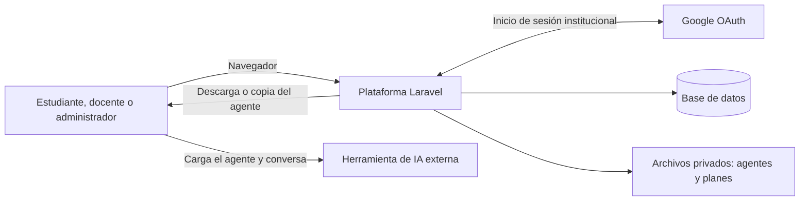
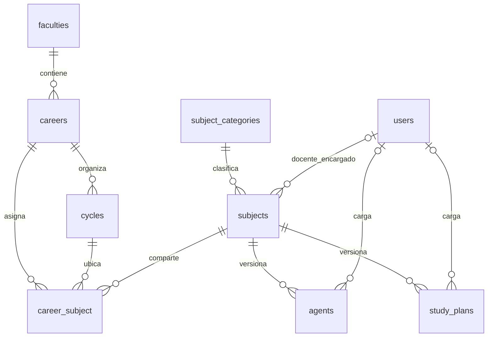
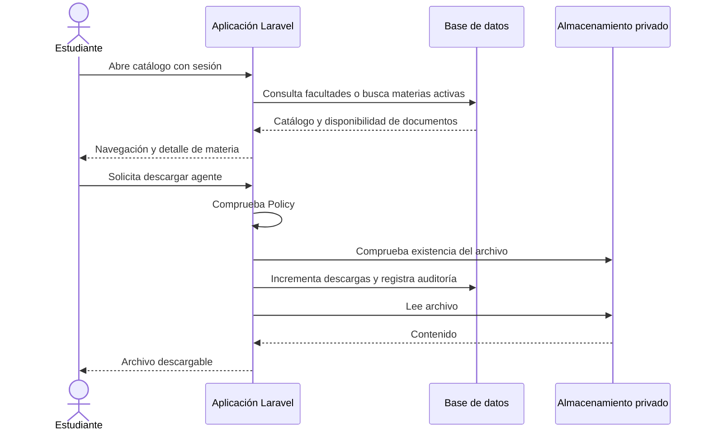

# Arquitectura de la plataforma y del catálogo de tutores socráticos

Proyecto: Tutores Socráticos para Asignaturas Comunes con Soporte de IA — UNICAES.
Actividad del cronograma: **1.2.1.1**, responsabilidad compartida de ambos ejecutores.
Versión: **0.1 — 26 de octubre de 2026**.
Estado: arquitectura implementada documentada; pendiente de revisión del equipo y asesor.

## 1. Propósito y alcance

La plataforma centraliza el acceso institucional a tutores socráticos por asignatura.
El estudiante encuentra una materia mediante el catálogo o la búsqueda, consulta su
información y obtiene el agente para utilizarlo en una herramienta de IA externa.
El docente gestiona los planes de sus materias y el administrador organiza el catálogo,
asigna roles y publica versiones de agentes.

Este documento describe el código disponible al corte indicado. No certifica aprobación
de requerimientos, calidad pedagógica de los agentes ni una instalación institucional.
La propuesta y el cronograma definen el alcance; los archivos de código enlazados aportan
evidencia de las decisiones implementadas. Las diferencias pendientes se explican en §9.

## 2. Contexto del sistema

La comunicación con Google corresponde a autenticación. La aplicación no llama a una
API de IA para responder preguntas académicas. El estudiante carga el agente en la
herramienta elegida y mantiene allí la conversación. Por ello, el catálogo no recibe
automáticamente transcripciones, errores conceptuales ni progreso de aprendizaje.

El acceso local de demostración permite revisar las pantallas sin Google; solo se
registra cuando `APP_ENV=local`, y su controlador comprueba también ese entorno.

## 3. Organización técnica

Se utiliza un monolito Laravel con vistas Blade y recursos compilados por Vite.
La navegación, autenticación, administración y descarga pertenecen a la misma aplicación.

| Componente | Responsabilidad | Evidencia |
|---|---|---|
| Rutas web | Define URL, sesión requerida, roles y límites de solicitudes | [web.php](../tutores/routes/web.php) |
| Controladores | Atienden catálogo, autenticación, administración y documentos | [CatalogController](../tutores/app/Http/Controllers/CatalogController.php), [DownloadController](../tutores/app/Http/Controllers/DownloadController.php) |
| Form Requests | Autorizan y validan operaciones de entrada | [StoreAgentRequest](../tutores/app/Http/Requests/StoreAgentRequest.php), [SubjectAssignmentRequest](../tutores/app/Http/Requests/SubjectAssignmentRequest.php) |
| Policies | Resuelven permisos sobre materias y documentos concretos | [SubjectPolicy](../tutores/app/Policies/SubjectPolicy.php), [AgentPolicy](../tutores/app/Policies/AgentPolicy.php), [StudyPlanPolicy](../tutores/app/Policies/StudyPlanPolicy.php) |
| Modelos Eloquent | Representan catálogo, usuarios, versiones y relaciones | [Subject](../tutores/app/Models/Subject.php), [User](../tutores/app/Models/User.php) |
| Servicio de documentos | Guarda archivos y metadatos, asigna versiones y registra eventos | [DocumentService](../tutores/app/Services/DocumentService.php) |
| Vistas y recursos | Presentan los flujos según el rol | [Vistas](../tutores/resources/views), [Vite](../tutores/vite.config.js) |
| Configuración | Define dominio, almacenamiento y límites de documentos | [tutores.php](../tutores/config/tutores.php), [filesystems.php](../tutores/config/filesystems.php) |
| Motor pedagógico | Compone un archivo de tutor con reglas comunes y un perfil por materia | [Motor y compilador](../tutores/agents/README.md) |

El manifiesto requiere PHP `^8.3` y Laravel `^13.8`. La instalación local verificada usa
PHP 8.3.12 y las dependencias fijadas en `composer.lock`. Las vistas emplean Tailwind CSS
y JavaScript compilados. El entorno local usa SQLite; MySQL está contemplado en la
configuración y documentación del proyecto, pero no se verificó en esta revisión.

## 4. Modelo del catálogo

| Entidad | Datos y restricciones relevantes |
|---|---|
| `faculties` | Facultad, slug, descripción y estado activo. |
| `careers` | Pertenece a una facultad; identifica carrera, plan y estado. |
| `cycles` | Pertenece a una carrera; número único dentro de esa carrera. |
| `subject_categories` | Clasifica materias, con nombre, slug y color. |
| `subjects` | Materia única por slug, categoría obligatoria y docente encargado opcional en la base. |
| `career_subject` | Asocia materia, carrera y ciclo; la combinación de los tres es única. |
| `agents` | Archivo, materia, autor de carga, versión, estado y contador de descargas. |
| `study_plans` | Archivo del plan por materia, autor de carga, versión y estado. |
| `users` | Identidad Google, correo, nombre y avatar; roles mediante tablas de Spatie. |
| `audits` | Eventos sobre modelos y operaciones explícitas, con actor y contexto. |

La ruta de navegación no significa que cada carrera tenga una copia de la materia.
Por ejemplo, una materia puede existir una vez y relacionarse con dos carreras mediante
dos filas de `career_subject`, cada una con su ciclo. Los agentes y planes pertenecen a
la materia y se comparten entre esas ubicaciones.

El formulario de asignación comprueba que el ciclo elegido pertenezca a la carrera.
Las claves foráneas de la tabla pivote comprueban existencia; la coherencia entre carrera
y ciclo se valida en la aplicación. Las eliminaciones tienen reglas de clave foránea
definidas en las [migraciones](../tutores/database/migrations).

## 5. Acceso y permisos

| Operación | Estudiante | Docente | Administrador |
|---|---|---|---|
| Navegar y buscar materias | Sí | Sí | Sí |
| Descargar o copiar agentes | Agente y materia activos | Agente y materia activos | Incluye versiones inactivas |
| Descargar planes | Versiones activas | Activas y versiones de sus materias | Todas |
| Subir, activar o eliminar planes | No | Solo sus materias | Sí |
| Subir, activar o eliminar agentes | No | No | Sí |
| Gestionar catálogo, asignaciones y roles | No | No | Sí |
| Consultar auditoría | No | No | Sí |

El middleware `auth` protege catálogo y documentos. Los paneles aplican middleware de
rol; los formularios de carga y las Policies añaden controles sobre las operaciones y
recursos. Los controladores de descarga consultan la Policy antes de acceder al archivo.
No todas las operaciones administrativas tienen una Policy propia: algunas se protegen
con el grupo `role:admin` y la autorización del Form Request.

El callback de Google valida el sufijo de correo contra el dominio configurado, antes
de crear el usuario. En el primer acceso se asigna estudiante si no hay roles; el acceso
de un usuario existente conserva su rol. Se regenera la sesión al iniciar sesión.
La prueba institucional real sigue pendiente de configurar las credenciales de Google.

## 6. Flujos principales

### 6.1 Buscar una materia y obtener su agente

La copia usa una ruta diferente que entrega JSON con nombre y contenido para documentos
de texto admitidos. Registra `agent.copied`; no incrementa el contador de descargas.
Los archivos PDF no se exponen mediante ese flujo de copia.

### 6.2 Incorporar una versión de agente o plan

1. El administrador carga un agente, o el docente encargado carga el plan de su materia.
2. El Form Request verifica permiso, campos, tipo de archivo y tamaño configurado.
3. `DocumentService` calcula la siguiente versión y desactiva las anteriores de esa materia.
4. Guarda el archivo con un nombre generado y registra su nombre original saneado,
   tamaño, tipo MIME, autor y versión en la base.
5. Registra el evento de carga. La nueva versión queda activa y aparece en la materia.

La actualización de metadatos ocurre dentro de una transacción de base de datos.
El almacenamiento de archivos no forma parte de esa transacción; no se garantiza una
reversión conjunta entre archivo y base ante fallos. La activación de versiones existentes
está implementada en los controladores, fuera del servicio de carga.

### 6.3 Preparar un tutor por asignatura

El compilador local combina `agents/motor-base.md` con un JSON de `agents/perfiles/` y
genera un Markdown autocontenido en `agents/borradores/`. Ese archivo incluye diagnóstico,
preguntas, niveles de ayuda, mini-evaluaciones, fuente y pendientes de la asignatura.
No necesita ejecutar Laravel ni consume una API de IA.

Después de revisar el material y las conversaciones, el docente puede evaluar el contenido
siguiendo el [protocolo de validación](validacion_tutores.md). El administrador carga la
versión aprobada mediante el flujo normal de agentes. No hay una integración automática
entre el compilador y el catálogo ni un estado de aprobación docente en el modelo `Agent`.

## 7. Almacenamiento y auditoría

Agentes y planes se almacenan en el disco `private`, con raíz `storage/app/private`.
Las descargas pasan por rutas autenticadas; el disco no genera enlaces públicos de
servicio. Los recursos gráficos y archivos CSS/JS sí se entregan desde `public`.

Se utilizan eventos de Eloquent con `owen-it/laravel-auditing` y eventos explícitos:
`agent.uploaded`, `study_plan.uploaded`, `agent.downloaded`, `agent.copied`,
`study_plan.downloaded` y `role.assigned`. El servicio registra actor, modelo, fecha,
URL, IP, agente de usuario y datos del evento. La visualización administrativa no ofrece
rutas para editar o borrar auditorías; eso no implica almacenamiento inmutable frente
a un administrador con acceso directo a la base de datos.

El contador de descargas se excluye de la auditoría automática del modelo Agent;
cada descarga tiene su evento específico. Las conversaciones externas no se auditan.

## 8. Ejecución y evidencia disponible

Para esta revisión se instalaron las dependencias, se ejecutaron las migraciones y
seeders locales y se compiló el frontend. El servidor se inicia con
`tutores/iniciar-local.cmd` y permite acceso de demostración en el entorno local.
El lanzador depende de la configuración PHP disponible en este equipo; los pasos
generales están en el [README](../tutores/README.md).

La [evidencia de verificación](verificacion_2026-10-26.md) registra 69 pruebas aprobadas
y 159 aserciones. Se comprobaron respuestas HTTP 200 para login, catálogo autenticado,
panel administrador y detalle de materia con agente. Estas comprobaciones no sustituyen
la validación docente, prueba institucional OAuth, prueba en MySQL ni pruebas de carga.

En la elaboración de este documento se contrastaron modelos, migraciones, validadores,
Policies, servicio, controladores y rutas registradas mediante `artisan route:list --json`.
No se modificó la funcionalidad ni se repitió la suite por cambios exclusivamente documentales.

## 9. Decisiones pendientes de revisión

| Tema | Situación comprobada | Decisión necesaria |
|---|---|---|
| Docente encargado | `subjects.teacher_id` admite nulos, aunque el diseño propone un docente por materia. | Definir si se permiten materias en preparación sin docente y en qué momento pasa a ser obligatorio. |
| Materias compartidas | Agentes y planes se asocian a materia, no a carrera ni cátedra. | Confirmar si un único contenido sirve para todas sus carreras o si se requieren variantes. |
| Reportes de aprendizaje | La propuesta menciona visibilidad de progreso, pero la conversación ocurre fuera de la web. | Acordar un procedimiento de evaluación externo o precisar el alcance, sin prometer reportes automáticos inexistentes. |
| Validación docente | El modelo solo distingue versiones activas e inactivas. | Definir cómo se registra la aprobación antes de cargar o activar un tutor. |
| Versiones y fallos | Numeración por máximo más uno y activación desde controladores; sin garantía de exclusión ante cargas simultáneas. | Revisar si la operación piloto necesita controles adicionales de concurrencia y recuperación de archivos. |
| Documentos subidos | Hay validación de tipo/tamaño y almacenamiento privado; no se identificó un servicio antivirus conectado. | Confirmar si el requisito de escaneo del diseño se mantiene y cómo se verificará. |
| Entorno institucional | Instalación y pruebas realizadas sobre SQLite local. | Confirmar entorno de validación, responsable de respaldos y necesidad de comprobar MySQL. |

Estos puntos se registran para resolver el alcance y sus criterios de cierre. No son
aprobaciones implícitas ni cambios ya ejecutados.

## 10. Criterios para cerrar la actividad 1.2.1.1

- [x] Describir el contexto y la separación entre catálogo y conversación externa.
- [x] Identificar componentes y sus responsabilidades con evidencia del código.
- [x] Documentar relaciones de facultad, carrera, ciclo, materia y documentos.
- [x] Describir flujos de permisos, carga, descarga y preparación de tutores.
- [x] Registrar diferencias y decisiones pendientes frente al diseño.
- [ ] Revisar las decisiones de §9 con el equipo y el asesor.
- [ ] Registrar conformidad y ajustar la versión del documento según lo acordado.

Registro de revisión pendiente: fecha, participantes, observaciones, decisión por punto,
versión revisada y referencia a la constancia de conformidad. No se asigna un porcentaje
de avance nuevo ni se declara aprobada la actividad con la sola creación de este documento.
